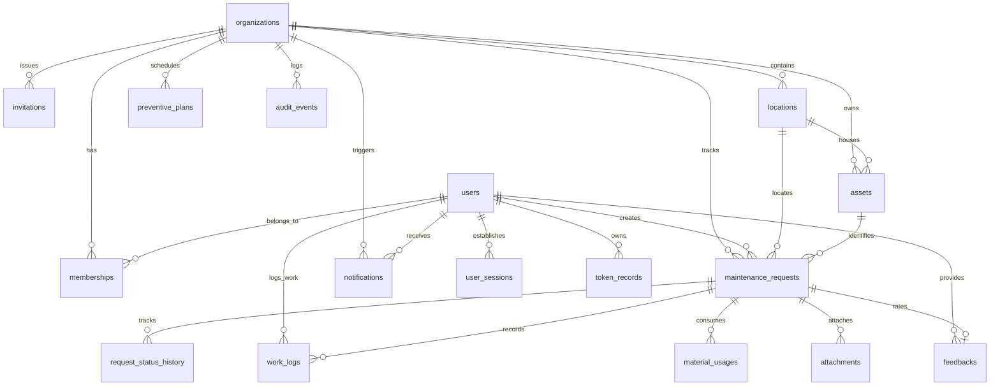

# ZERVUONO — Database Schema & Data Dictionary

## 1. Relational Database Overview

ZERVUONO utilizes **PostgreSQL** (hosted cloud-native on **Neon**) as its relational database. The schema is normalized (3NF), strictly typed, and enforced through foreign key constraints, unique indexes, and timezone-aware timestamps.

### Architectural Highlights
- **Primary Keys:** Every table uses standard 36-character UUID strings (`String(36)` / `generate_uuid`) generated at the application level to ensure deterministic ID creation across distributed environments.
- **Timestamp Tracking:** Audited tables inherit from `TimestampMixin` with `created_at` and `updated_at` storing timezone-aware UTC timestamps (`DateTime(timezone=True)`).
- **Multi-Tenant Partitioning:** Relational tables include an `organization_id` column with foreign key constraints cascading on deletion (`ondelete="CASCADE"`).
- **Persistent Binary Object Storage:** The `attachments` table features a `BYTEA` column (`file_data`) enabling database-level persistence for photo evidence.

---

## 2. Entity-Relationship Diagram (ERD)

---

## 3. Data Dictionary: Complete Table Specifications

### 3.1. `organizations`
Represents independent corporate or institutional tenants.

| Column | Data Type | Nullable | Default | Constraints / Description |
|---|---|:---:|---|---|
| `id` | `VARCHAR(36)` | NO | UUIDv4 | Primary Key |
| `name` | `VARCHAR(255)` | NO | — | Legal or display organization name |
| `slug` | `VARCHAR(100)` | NO | — | Unique, Indexed. URL-safe slug (e.g., `apex-logistics`) |
| `domain` | `VARCHAR(255)` | YES | NULL | Custom web domain or email domain |
| `settings` | `TEXT` | YES | NULL | JSON string of tenant settings |
| `logo_url` | `VARCHAR(500)` | YES | NULL | Organization brand logo URL |
| `is_active` | `BOOLEAN` | NO | `TRUE` | Active operational status |
| `created_at` | `TIMESTAMP WITH TIME ZONE` | NO | UTC NOW | Record creation timestamp |
| `updated_at` | `TIMESTAMP WITH TIME ZONE` | NO | UTC NOW | Last update timestamp |

---

### 3.2. `users`
Global user identity table storing cryptographic credentials and profile details.

| Column | Data Type | Nullable | Default | Constraints / Description |
|---|---|:---:|---|---|
| `id` | `VARCHAR(36)` | NO | UUIDv4 | Primary Key |
| `email` | `VARCHAR(255)` | NO | — | Unique, Indexed. Normalized lowercase email |
| `hashed_password` | `VARCHAR(255)` | NO | — | Argon2id memory-hard password hash |
| `full_name` | `VARCHAR(255)` | NO | — | User's full display name |
| `phone` | `VARCHAR(50)` | YES | NULL | Contact telephone number |
| `avatar_url` | `VARCHAR(500)` | YES | NULL | Profile photo URL |
| `is_active` | `BOOLEAN` | NO | `TRUE` | Account active flag |
| `is_verified` | `BOOLEAN` | NO | `TRUE` | Email verification flag |
| `created_at` | `TIMESTAMP WITH TIME ZONE` | NO | UTC NOW | Record creation timestamp |
| `updated_at` | `TIMESTAMP WITH TIME ZONE` | NO | UTC NOW | Last update timestamp |

---

### 3.3. `memberships`
Links users to organizations with specific role permissions. Enforces unique user-organization pairs.

| Column | Data Type | Nullable | Default | Constraints / Description |
|---|---|:---:|---|---|
| `id` | `VARCHAR(36)` | NO | UUIDv4 | Primary Key |
| `user_id` | `VARCHAR(36)` | NO | — | FK → `users.id` (`ON DELETE CASCADE`), Indexed |
| `organization_id`| `VARCHAR(36)` | NO | — | FK → `organizations.id` (`ON DELETE CASCADE`), Indexed |
| `role` | `VARCHAR(50)` | NO | — | Role: `Admin`, `Manager`, `Technician`, `Customer` |
| `title` | `VARCHAR(100)` | YES | NULL | Job title (e.g., "Senior Electro-Mechanical Specialist") |
| `department` | `VARCHAR(100)` | YES | NULL | Operational department name |
| `is_active` | `BOOLEAN` | NO | `TRUE` | Active membership flag |
| `joined_at` | `TIMESTAMP WITH TIME ZONE` | NO | UTC NOW | Date user joined organization |

**Unique Constraint:** `uq_user_organization` (`user_id`, `organization_id`)

---

### 3.4. `user_sessions`
Tracks active refresh tokens, client devices, and session validity.

| Column | Data Type | Nullable | Default | Constraints / Description |
|---|---|:---:|---|---|
| `id` | `VARCHAR(36)` | NO | UUIDv4 | Primary Key |
| `user_id` | `VARCHAR(36)` | NO | — | FK → `users.id` (`ON DELETE CASCADE`), Indexed |
| `refresh_token_hash`| `VARCHAR(255)`| NO | — | Indexed cryptographic hash of refresh token |
| `expires_at` | `TIMESTAMP WITH TIME ZONE` | NO | — | Session expiration timestamp |
| `ip_address` | `VARCHAR(100)` | YES | NULL | Client IP address |
| `user_agent` | `TEXT` | YES | NULL | Client browser / device user agent |
| `is_revoked` | `BOOLEAN` | NO | `FALSE` | Explicit session revocation flag |
| `created_at` | `TIMESTAMP WITH TIME ZONE` | NO | UTC NOW | Session establishment timestamp |

---

### 3.5. `token_records`
Manages single-use authentication tokens (e.g., password reset, email verification).

| Column | Data Type | Nullable | Default | Constraints / Description |
|---|---|:---:|---|---|
| `id` | `VARCHAR(36)` | NO | UUIDv4 | Primary Key |
| `user_id` | `VARCHAR(36)` | NO | — | FK → `users.id` (`ON DELETE CASCADE`), Indexed |
| `token` | `VARCHAR(255)` | NO | — | Unique, Indexed. Cryptographically random token |
| `token_type` | `VARCHAR(50)` | NO | — | `password_reset`, `email_verification` |
| `expires_at` | `TIMESTAMP WITH TIME ZONE` | NO | — | Token validity expiration timestamp |
| `used_at` | `TIMESTAMP WITH TIME ZONE` | YES | NULL | Timestamp when token was consumed |
| `created_at` | `TIMESTAMP WITH TIME ZONE` | NO | UTC NOW | Creation timestamp |

---

### 3.6. `invitations`
Tracks invitations issued by Admins to onboard new users into organizations.

| Column | Data Type | Nullable | Default | Constraints / Description |
|---|---|:---:|---|---|
| `id` | `VARCHAR(36)` | NO | UUIDv4 | Primary Key |
| `organization_id`| `VARCHAR(36)` | NO | — | FK → `organizations.id` (`ON DELETE CASCADE`), Indexed |
| `email` | `VARCHAR(255)` | NO | — | Indexed. Recipient email address |
| `role` | `VARCHAR(50)` | NO | — | Target role: `Admin`, `Manager`, `Technician`, `Customer` |
| `token` | `VARCHAR(255)` | NO | — | Unique, Indexed. Invitation claim token |
| `invited_by_id` | `VARCHAR(36)` | YES | NULL | FK → `users.id` (`ON DELETE SET NULL`) |
| `status` | `VARCHAR(50)` | NO | `'Pending'`| `Pending`, `Accepted`, `Revoked`, `Expired` |
| `expires_at` | `TIMESTAMP WITH TIME ZONE` | NO | — | Expiration timestamp (7 days) |
| `accepted_at` | `TIMESTAMP WITH TIME ZONE` | YES | NULL | Acceptance timestamp |
| `created_at` | `TIMESTAMP WITH TIME ZONE` | NO | UTC NOW | Creation timestamp |

---

### 3.7. `locations`
Physical buildings, facilities, floors, and rooms within an organization.

| Column | Data Type | Nullable | Default | Constraints / Description |
|---|---|:---:|---|---|
| `id` | `VARCHAR(36)` | NO | UUIDv4 | Primary Key |
| `organization_id`| `VARCHAR(36)` | NO | — | FK → `organizations.id` (`ON DELETE CASCADE`), Indexed |
| `name` | `VARCHAR(255)` | NO | — | Location name (e.g., "North Wing - Logistics Hub") |
| `building` | `VARCHAR(100)` | YES | NULL | Building identifier (e.g., "Building A") |
| `floor` | `VARCHAR(50)` | YES | NULL | Floor level (e.g., "Ground Floor") |
| `room` | `VARCHAR(50)` | YES | NULL | Specific room / bay (e.g., "Main Bay") |
| `address` | `TEXT` | YES | NULL | Full physical street address |
| `is_active` | `BOOLEAN` | NO | `TRUE` | Active status flag |
| `created_at` | `TIMESTAMP WITH TIME ZONE` | NO | UTC NOW | Record creation timestamp |
| `updated_at` | `TIMESTAMP WITH TIME ZONE` | NO | UTC NOW | Last update timestamp |

---

### 3.8. `assets`
Physical equipment, machines, and infrastructure assets tracked by the organization.

| Column | Data Type | Nullable | Default | Constraints / Description |
|---|---|:---:|---|---|
| `id` | `VARCHAR(36)` | NO | UUIDv4 | Primary Key |
| `organization_id`| `VARCHAR(36)` | NO | — | FK → `organizations.id` (`ON DELETE CASCADE`), Indexed |
| `location_id` | `VARCHAR(36)` | YES | NULL | FK → `locations.id` (`ON DELETE SET NULL`), Indexed |
| `name` | `VARCHAR(255)` | NO | — | Equipment name (e.g., "Main Rooftop Chiller Unit #3") |
| `asset_tag` | `VARCHAR(100)` | NO | — | Indexed. Physical tag (e.g., `EQ-CHILLER-03`) |
| `category` | `VARCHAR(100)` | NO | — | Indexed. Category: `HVAC`, `Electrical`, `Plumbing`, etc. |
| `manufacturer` | `VARCHAR(100)` | YES | NULL | Equipment maker (e.g., "Carrier") |
| `model` | `VARCHAR(100)` | YES | NULL | Equipment model designation |
| `serial_number` | `VARCHAR(100)` | YES | NULL | Manufacturer serial number |
| `installation_date`| `DATE` | YES | NULL | Date of installation |
| `warranty_expiration`| `DATE`| YES | NULL | Warranty expiry date |
| `status` | `VARCHAR(50)` | NO | `'Operational'` | `Operational`, `Degraded`, `In Repair`, `Decommissioned` |
| `criticality` | `VARCHAR(50)` | NO | `'Medium'` | `Low`, `Medium`, `High`, `Critical` |
| `notes` | `TEXT` | YES | NULL | Engineering / maintenance notes |
| `created_at` | `TIMESTAMP WITH TIME ZONE` | NO | UTC NOW | Record creation timestamp |
| `updated_at` | `TIMESTAMP WITH TIME ZONE` | NO | UTC NOW | Last update timestamp |

---

### 3.9. `maintenance_requests`
Core work order entity tracking the full lifecycle of a maintenance request.

| Column | Data Type | Nullable | Default | Constraints / Description |
|---|---|:---:|---|---|
| `id` | `VARCHAR(36)` | NO | UUIDv4 | Primary Key |
| `organization_id`| `VARCHAR(36)` | NO | — | FK → `organizations.id` (`ON DELETE CASCADE`), Indexed |
| `request_number`| `VARCHAR(50)` | NO | — | Indexed. Scoped human ID (e.g., `REQ-1001`) |
| `title` | `VARCHAR(255)` | NO | — | Short descriptive summary of issue |
| `description` | `TEXT` | NO | — | Detailed symptoms and failure report |
| `category` | `VARCHAR(100)` | NO | — | Indexed. `HVAC`, `Electrical`, `Plumbing`, `Mechanical`, etc. |
| `priority` | `VARCHAR(50)` | NO | `'Medium'` | `Low`, `Medium`, `High`, `Urgent` |
| `status` | `VARCHAR(50)` | NO | `'Submitted'` | Indexed. State machine status |
| `requester_id` | `VARCHAR(36)` | NO | — | FK → `users.id` (`ON DELETE RESTRICT`), Indexed |
| `location_id` | `VARCHAR(36)` | YES | NULL | FK → `locations.id` (`ON DELETE SET NULL`), Indexed |
| `location_details`| `VARCHAR(255)`| YES | NULL | Supplemental location directions |
| `asset_id` | `VARCHAR(36)` | YES | NULL | FK → `assets.id` (`ON DELETE SET NULL`), Indexed |
| `assigned_technician_id`| `VARCHAR(36)`| YES | NULL | FK → `users.id` (`ON DELETE SET NULL`), Indexed |
| `due_date` | `TIMESTAMP WITH TIME ZONE` | YES | NULL | SLA completion deadline |
| `manager_instructions`| `TEXT` | YES | NULL | Specific instructions provided by dispatching manager |
| `completion_summary`| `TEXT` | YES | NULL | Technician's final resolution report |
| `reopen_reason` | `TEXT` | YES | NULL | Customer justification when reopening ticket |
| `reopen_count` | `INTEGER` | NO | `0` | Number of times ticket was reopened |
| `closed_at` | `TIMESTAMP WITH TIME ZONE` | YES | NULL | Timestamp when customer verified & closed |
| `created_at` | `TIMESTAMP WITH TIME ZONE` | NO | UTC NOW | Record creation timestamp |
| `updated_at` | `TIMESTAMP WITH TIME ZONE` | NO | UTC NOW | Last update timestamp |

**Unique Constraint:** `uq_org_request_number` (`organization_id`, `request_number`)

---

### 3.10. `request_status_history`
Immutable event log tracking all state transitions for a maintenance request.

| Column | Data Type | Nullable | Default | Constraints / Description |
|---|---|:---:|---|---|
| `id` | `VARCHAR(36)` | NO | UUIDv4 | Primary Key |
| `request_id` | `VARCHAR(36)` | NO | — | FK → `maintenance_requests.id` (`ON DELETE CASCADE`), Indexed |
| `actor_id` | `VARCHAR(36)` | YES | NULL | FK → `users.id` (`ON DELETE SET NULL`) |
| `from_status` | `VARCHAR(50)` | YES | NULL | Previous status (or `NULL` on creation) |
| `to_status` | `VARCHAR(50)` | NO | — | New status |
| `action` | `VARCHAR(100)` | NO | — | Action name (e.g., `REQUEST_CREATED`, `TECHNICIAN_ASSIGNED`) |
| `comment` | `TEXT` | YES | NULL | Transition commentary or notes |
| `created_at` | `TIMESTAMP WITH TIME ZONE` | NO | UTC NOW | Timestamp of transition event |

---

### 3.11. `work_logs`
Records on-site labor hours, technical diagnosis, and actions taken by technicians.

| Column | Data Type | Nullable | Default | Constraints / Description |
|---|---|:---:|---|---|
| `id` | `VARCHAR(36)` | NO | UUIDv4 | Primary Key |
| `request_id` | `VARCHAR(36)` | NO | — | FK → `maintenance_requests.id` (`ON DELETE CASCADE`), Indexed |
| `technician_id` | `VARCHAR(36)` | NO | — | FK → `users.id` (`ON DELETE RESTRICT`), Indexed |
| `diagnosis` | `TEXT` | YES | NULL | Root cause engineering diagnosis |
| `actions_taken` | `TEXT` | NO | — | Itemized procedures performed |
| `hours_spent` | `FLOAT` | NO | `0.0` | Billable / tracked labor hours |
| `created_at` | `TIMESTAMP WITH TIME ZONE` | NO | UTC NOW | Work log timestamp |

---

### 3.12. `material_usages`
Tracks spare parts, replacement consumables, and associated costs.

| Column | Data Type | Nullable | Default | Constraints / Description |
|---|---|:---:|---|---|
| `id` | `VARCHAR(36)` | NO | UUIDv4 | Primary Key |
| `request_id` | `VARCHAR(36)` | NO | — | FK → `maintenance_requests.id` (`ON DELETE CASCADE`), Indexed |
| `technician_id` | `VARCHAR(36)` | NO | — | FK → `users.id` (`ON DELETE RESTRICT`) |
| `item_name` | `VARCHAR(255)` | NO | — | Part name (e.g., "Browning V-Belt A-42") |
| `quantity` | `FLOAT` | NO | — | Quantity consumed |
| `unit` | `VARCHAR(50)` | NO | `'pcs'` | Measurement unit (`pcs`, `liters`, `meters`) |
| `cost` | `FLOAT` | YES | NULL | Unit or total part cost |
| `created_at` | `TIMESTAMP WITH TIME ZONE` | NO | UTC NOW | Consumption timestamp |

---

### 3.13. `attachments`
Stores before/after photos, diagnostic documentation, and persistent binary image data.

| Column | Data Type | Nullable | Default | Constraints / Description |
|---|---|:---:|---|---|
| `id` | `VARCHAR(36)` | NO | UUIDv4 | Primary Key |
| `organization_id`| `VARCHAR(36)` | NO | — | FK → `organizations.id` (`ON DELETE CASCADE`), Indexed |
| `request_id` | `VARCHAR(36)` | YES | NULL | FK → `maintenance_requests.id` (`ON DELETE CASCADE`), Indexed |
| `uploaded_by_id`| `VARCHAR(36)` | NO | — | FK → `users.id` (`ON DELETE RESTRICT`) |
| `file_name` | `VARCHAR(255)` | NO | — | Original file name |
| `file_size` | `INTEGER` | NO | — | File size in bytes |
| `mime_type` | `VARCHAR(100)` | NO | — | MIME content type (e.g., `image/jpeg`, `image/png`) |
| `storage_key` | `VARCHAR(500)` | NO | — | Unique relative storage key path |
| `url` | `VARCHAR(1000)`| NO | — | Public streaming URL (`/api/v1/files/{id}/view`) |
| `file_data` | `BYTEA` | YES | NULL | **Persistent binary file content in PostgreSQL** |
| `attachment_type`| `VARCHAR(50)` | NO | `'Initial'`| `Initial`, `Before`, `After`, `Document` |
| `created_at` | `TIMESTAMP WITH TIME ZONE` | NO | UTC NOW | Upload timestamp |

---

### 3.14. `feedbacks`
Customer review and satisfaction rating submitted upon work verification.

| Column | Data Type | Nullable | Default | Constraints / Description |
|---|---|:---:|---|---|
| `id` | `VARCHAR(36)` | NO | UUIDv4 | Primary Key |
| `request_id` | `VARCHAR(36)` | NO | — | Unique, FK → `maintenance_requests.id` (`ON DELETE CASCADE`) |
| `customer_id` | `VARCHAR(36)` | NO | — | FK → `users.id` (`ON DELETE RESTRICT`) |
| `rating` | `INTEGER` | NO | — | Star rating between `1` and `5` |
| `comments` | `TEXT` | YES | NULL | Customer satisfaction review text |
| `created_at` | `TIMESTAMP WITH TIME ZONE` | NO | UTC NOW | Feedback submission timestamp |

---

### 3.15. `preventive_plans`
Defines recurring preventative maintenance schedules for physical assets or locations.

| Column | Data Type | Nullable | Default | Constraints / Description |
|---|---|:---:|---|---|
| `id` | `VARCHAR(36)` | NO | UUIDv4 | Primary Key |
| `organization_id`| `VARCHAR(36)` | NO | — | FK → `organizations.id` (`ON DELETE CASCADE`), Indexed |
| `title` | `VARCHAR(255)` | NO | — | Plan title (e.g., "Monthly Chiller Filter Inspection") |
| `description` | `TEXT` | YES | NULL | Scope of work description |
| `asset_id` | `VARCHAR(36)` | YES | NULL | FK → `assets.id` (`ON DELETE SET NULL`), Indexed |
| `location_id` | `VARCHAR(36)` | YES | NULL | FK → `locations.id` (`ON DELETE SET NULL`), Indexed |
| `frequency` | `VARCHAR(50)` | NO | — | `Weekly`, `Monthly`, `Quarterly`, `Semi-Annual`, `Annual` |
| `assigned_technician_id`| `VARCHAR(36)`| YES | NULL | FK → `users.id` (`ON DELETE SET NULL`) |
| `checklist` | `TEXT` | YES | NULL | JSON array of checklist items |
| `is_active` | `BOOLEAN` | NO | `TRUE` | Schedule active flag |
| `next_due_date` | `DATE` | NO | — | Indexed. Next scheduled service date |
| `last_generated_at`| `TIMESTAMP WITH TIME ZONE`| YES | NULL | Timestamp when work order was last spawned |
| `created_at` | `TIMESTAMP WITH TIME ZONE` | NO | UTC NOW | Record creation timestamp |
| `updated_at` | `TIMESTAMP WITH TIME ZONE` | NO | UTC NOW | Last update timestamp |

---

### 3.16. `notifications`
In-app notification alerts delivered to users for dispatch and state updates.

| Column | Data Type | Nullable | Default | Constraints / Description |
|---|---|:---:|---|---|
| `id` | `VARCHAR(36)` | NO | UUIDv4 | Primary Key |
| `organization_id`| `VARCHAR(36)` | NO | — | FK → `organizations.id` (`ON DELETE CASCADE`), Indexed |
| `recipient_id` | `VARCHAR(36)` | NO | — | FK → `users.id` (`ON DELETE CASCADE`), Indexed |
| `title` | `VARCHAR(255)` | NO | — | Alert headline |
| `message` | `TEXT` | NO | — | Full alert text |
| `notification_type`| `VARCHAR(50)`| NO | — | Event code (e.g., `REQUEST_CREATED`, `ASSIGNED`) |
| `request_id` | `VARCHAR(36)` | YES | NULL | FK → `maintenance_requests.id` (`ON DELETE CASCADE`), Indexed |
| `is_read` | `BOOLEAN` | NO | `FALSE` | Indexed. Read status |
| `read_at` | `TIMESTAMP WITH TIME ZONE` | YES | NULL | Timestamp when read |
| `created_at` | `TIMESTAMP WITH TIME ZONE` | NO | UTC NOW | Notification creation timestamp |
| `updated_at` | `TIMESTAMP WITH TIME ZONE` | NO | UTC NOW | Last update timestamp |

---

### 3.17. `audit_events`
Write-only compliance log tracking critical security and administrative actions.

| Column | Data Type | Nullable | Default | Constraints / Description |
|---|---|:---:|---|---|
| `id` | `VARCHAR(36)` | NO | UUIDv4 | Primary Key |
| `organization_id`| `VARCHAR(36)` | NO | — | FK → `organizations.id` (`ON DELETE CASCADE`), Indexed |
| `actor_id` | `VARCHAR(36)` | YES | NULL | FK → `users.id` (`ON DELETE SET NULL`), Indexed |
| `entity_type` | `VARCHAR(50)` | NO | — | Indexed. `REQUEST`, `USER`, `ASSET`, `LOCATION`, `AUTH` |
| `entity_id` | `VARCHAR(36)` | YES | NULL | Indexed. Target entity UUID |
| `action` | `VARCHAR(100)` | NO | — | Action verb (e.g., `USER_LOGIN`, `USER_REGISTERED`) |
| `details` | `TEXT` | YES | NULL | Descriptive details or JSON audit payload |
| `ip_address` | `VARCHAR(100)` | YES | NULL | IP address of client |
| `created_at` | `TIMESTAMP WITH TIME ZONE` | NO | UTC NOW | Indexed. Audit timestamp |

---

## 4. Indexing Strategy & Performance Considerations

1. **Composite Unique Index:** `organizations(slug)` and `uq_org_request_number(organization_id, request_number)` guarantee zero collisions across organizations.
2. **Foreign Key Indexes:** All foreign keys are explicitly indexed to maintain sub-millisecond join times when querying related records via SQLAlchemy `joinedload` and `selectinload`.
3. **Status & Category Indexes:** `maintenance_requests(status)` and `maintenance_requests(category)` optimize dashboard filtering queries across thousands of records.
4. **Timezone Standardization:** All timestamps use PostgreSQL's `TIMESTAMPTZ` data type, guaranteeing uniform UTC storage regardless of server or database cluster timezones.
