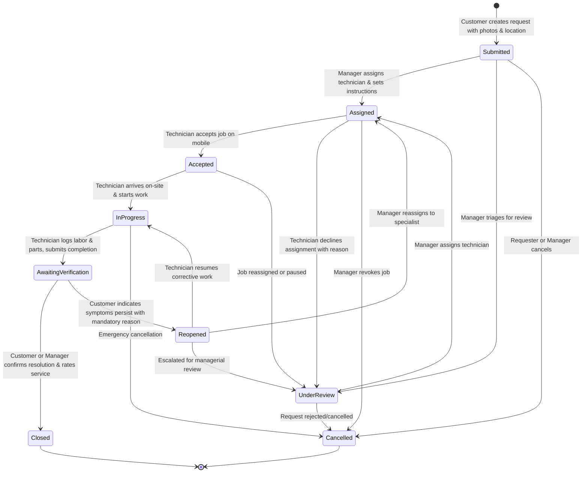

# ZERVUONO — Project Overview & Workflow Specification

## 1. Executive Summary

**ZERVUONO** is a modern, cloud-native Maintenance Operations and Computerized Maintenance Management System (CMMS) SaaS platform designed to manage the end-to-end lifecycle of equipment repairs, facility upkeep, preventive maintenance schedules, and technician field operations.

In modern industrial facilities, logistics warehouses, healthcare campuses, and corporate real estate, equipment failures and delayed maintenance lead to costly downtime, safety hazards, and customer dissatisfaction. ZERVUONO replaces disjointed communication channels (such as paper work orders, phone calls, and unmonitored messaging chats) with a deterministic, fully audited digital operating rhythm:

$$\text{Customer Reports} \longrightarrow \text{Manager Dispatches} \longrightarrow \text{Technician Repairs} \longrightarrow \text{Customer Verifies} \longrightarrow \text{System Closes \& Audits}$$

The platform is designed with a multi-tenant architecture, ensuring complete data isolation between different client organizations while running on a unified, high-performance cloud stack (React 18, TypeScript, FastAPI, PostgreSQL, and SQLAlchemy 2).

---

## 2. Target Users & Personas

ZERVUONO is engineered specifically for four interconnected roles within an enterprise or commercial facility:

| Role | Persona Name in Demo | Primary Responsibility | Daily Operational Goals |
|---|---|---|---|
| **Customer / Requester** | Elena Rostova | Warehouse Operations Supervisor | Report facility breakdowns quickly, track repair status in real-time, inspect completion photos, verify resolution, and rate technician service. |
| **Operations / Facility Manager** | David Miller | Facilities Maintenance Lead | Review incoming issue queue, assess priority, evaluate technician workload, assign jobs with dispatch instructions, manage preventative maintenance, and monitor operational KPIs. |
| **Field Service Technician** | Alex Vance | Senior Electro-Mechanical Specialist | Access mobile job board on-site, accept assignments, diagnose faults with AI assistance, record labor hours and spare parts consumed, capture before/after photos, and submit work completion proof. |
| **Organization Administrator** | Sarah Jenkins | Operations Director | Manage organization profiles, invite and govern team members across roles, maintain facility location hierarchies and physical asset registries, and audit compliance logs. |

---

## 3. Core Objectives

1. **Eliminate Operational Black Holes:** Provide 100% transparency into the status, assigned personnel, location, and progress of every maintenance request from submission to closure.
2. **Enforce Deterministic Lifecycle States:** Implement a strict backend state machine where requests can only transition through validated states, preventing skipped approvals or unverified closures.
3. **Guarantee Proof of Work:** Require itemized labor hours, diagnosis notes, replacement part tracking, and photographic evidence before any job can be submitted for verification.
4. **Ensure Multi-Tenant Security & Compliance:** Enforce tenant data scoping at the database level so that no user or organization can ever view, modify, or leak data belonging to another tenant.
5. **Accelerate Field Diagnostics with AI:** Integrate natural language fault categorization and AI-assisted troubleshooting powered by Google Gemini, grounded in historical organization repair records.
6. **Deliver Responsive Cross-Device Access:** Provide an intuitive, desktop-optimized dashboard for Managers and Admins, alongside a streamlined, touch-friendly mobile interface for Technicians and Customers.

---

## 4. Project Scope

### In-Scope Functional Modules
- **Authentication & RBAC:** Multi-role registration, login, session tokens (JWT + secure cookies), password reset, and role-based route guards.
- **Multi-Tenant Organization Management:** Organization registration, custom subdomains/slugs, member rosters, and role-specific email invitations.
- **Maintenance Request Engine:** Full lifecycle state machine (`Submitted`, `Under Review`, `Assigned`, `Accepted`, `In Progress`, `Awaiting Verification`, `Reopened`, `Closed`, `Cancelled`).
- **Dispatch & Assignment:** Workload-aware technician assignment, SLA priority assignment (`Low`, `Medium`, `High`, `Urgent`), and manager dispatch instructions.
- **Technician Field Execution:** Mobile acceptance, self-service job claiming, labor hour logging, material/part usage tracking, and completion reporting.
- **Verification & Feedback Loop:** Customer verification modal, 1–5 star service ratings, and structured reopen reasons if repairs fail quality checks.
- **Persistent Evidence & File Storage:** Multipart photo upload with database `BYTEA` storage, direct inline streaming (`/api/v1/files/{id}/view`), and S3 fallback.
- **Facility Locations & Asset Registry:** Hierarchical building/floor/room management and asset metadata tracking (serial numbers, warranties, criticality).
- **Preventive Maintenance (PM):** Scheduled recurring maintenance plans (Weekly, Monthly, Quarterly, Annual) with on-demand manual triggers.
- **Operational Analytics & KPI Reporting:** Live calculation of total requests, resolution time averages, technician workloads, reopen rates, and status distributions.
- **Immutable Audit Logging:** Persistent logging of security, authentication, assignment, and status transition events.

### Out-of-Scope (Future Enhancements)
- Native mobile applications on iOS App Store and Google Play (currently delivered via responsive Progressive Web Design).
- Direct integration with industrial IoT hardware protocols (e.g., Modbus, BACnet, MQTT telematics).
- Automated payment gateway billing and invoicing for external contractor billing (e.g., Stripe, QuickBooks).
- Offline-first IndexedDB background synchronization for areas with zero cellular connectivity.

---

## 5. Complete Maintenance Workflow State Machine

The core business logic of ZERVUONO is governed by a strictly enforced finite state machine implemented in `backend/app/core/state_machine.py`. Every transition is validated by the backend before database persistence.

### Detailed Lifecycle Stages

#### Stage 1: Issue Submission (`Submitted`)
- **Actor:** Customer (or Manager on behalf of a tenant).
- **Action:** User submits ticket specifying title, category (e.g., HVAC, Electrical, Plumbing, Mechanical), detailed description, location (building, floor, room), and optional photos.
- **System Event:** Backend generates a human-readable request code (e.g., `REQ-1001`), creates a status history entry, and notifies managers in the organization.

#### Stage 2: Manager Triage & Dispatch (`Assigned`)
- **Actor:** Operations Manager or Admin.
- **Action:** Manager reviews incoming tickets, verifies severity, sets SLA priority (`Low`, `Medium`, `High`, `Urgent`), selects an available technician from the roster, and enters specific instructions.
- **System Event:** Request status updates to `Assigned`. An in-app notification is dispatched to the technician.

#### Stage 3: Technician Acceptance (`Accepted`)
- **Actor:** Field Service Technician.
- **Action:** Technician opens their mobile dashboard, reviews instructions, location, and equipment tag, and clicks **Accept Job**. If unavailable or lacking specialized tooling, the technician clicks **Decline**, which transitions the request to `Under Review` for manager reassignment.
- **System Event:** Status changes to `Accepted` with actor audit logging.

#### Stage 4: On-Site Execution (`In Progress`)
- **Actor:** Field Service Technician.
- **Action:** Upon arriving at the equipment location, the technician clicks **Start Work**. During execution, the technician can:
  - Add **Work Logs** detailing root cause diagnosis, corrective actions taken, and elapsed labor hours.
  - Record **Materials Consumed** including part names, quantities, units, and unit costs.
  - Open **AI Troubleshoot Drawer** for Gemini-powered diagnostic checklists and similar past resolved issues.
- **System Event:** Status updates to `In Progress`. Timestamp is recorded for technician response time analytics.

#### Stage 5: Completion Proof Filing (`Awaiting Verification`)
- **Actor:** Field Service Technician.
- **Action:** Technician finishes physical repairs, uploads "After" photos demonstrating resolution, enters a completion summary, logs final hours, and submits.
- **System Event:** Status transitions to `Awaiting Verification`. An urgent alert banner appears on the Customer dashboard.

#### Stage 6: Customer Verification & Sign-Off (`Closed`)
- **Actor:** Customer.
- **Action:** Customer inspects the equipment and completion notes in their hub.
  - **Resolution Confirmed:** Customer clicks **Verify & Close**, submits an optional 1–5 star rating with comments. The request status becomes `Closed`.
  - **Resolution Rejected:** If equipment remains dysfunctional, customer clicks **Reopen Request**, entering mandatory feedback on why the fix failed. Status transitions to `Reopened`, incrementing `reopen_count`.
- **System Event:** If closed, `closed_at` timestamp is written, feeding resolution time KPIs. If reopened, manager and technician are alerted immediately.

---

## 6. Summary Matrix

| State | Allowed Transitions | Permitted Roles | Key Database Updates |
|---|---|---|---|
| `Submitted` | `Under Review`, `Assigned`, `Accepted`, `Cancelled` | Customer, Manager, Admin | `request_number`, `status_history` |
| `Under Review` | `Assigned`, `Accepted`, `Cancelled` | Manager, Admin | `manager_instructions` |
| `Assigned` | `Accepted`, `Under Review`, `Cancelled` | Manager, Admin | `assigned_technician_id`, `due_date`, `priority` |
| `Accepted` | `In Progress`, `Under Review`, `Cancelled` | Technician, Manager, Admin | `status_history` |
| `In Progress` | `Awaiting Verification`, `Cancelled` | Technician, Manager, Admin | `work_logs`, `material_usages` |
| `Awaiting Verification` | `Closed`, `Reopened` | Customer, Manager, Admin | `completion_summary`, `attachments` |
| `Reopened` | `In Progress`, `Assigned`, `Under Review` | Customer, Manager, Admin | `reopen_reason`, `reopen_count++` |
| `Closed` | *Terminal State* | System / Customer | `closed_at`, `feedbacks` |
| `Cancelled` | *Terminal State* | Customer, Manager, Admin | `status_history` |

This disciplined workflow ensures that no maintenance job in ZERVUONO is ever forgotten, unaccounted for, or marked done without authentic proof.
