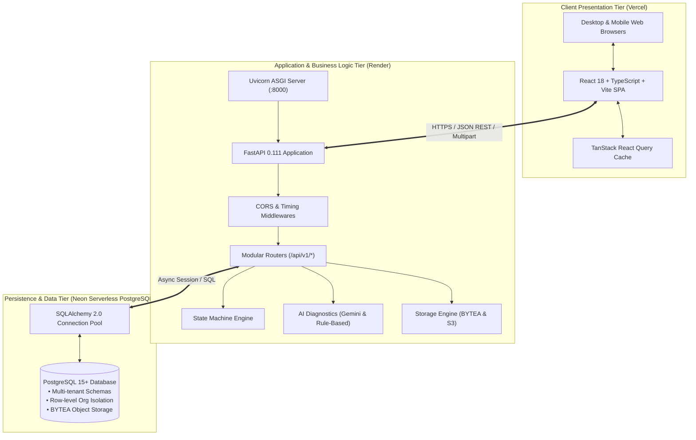
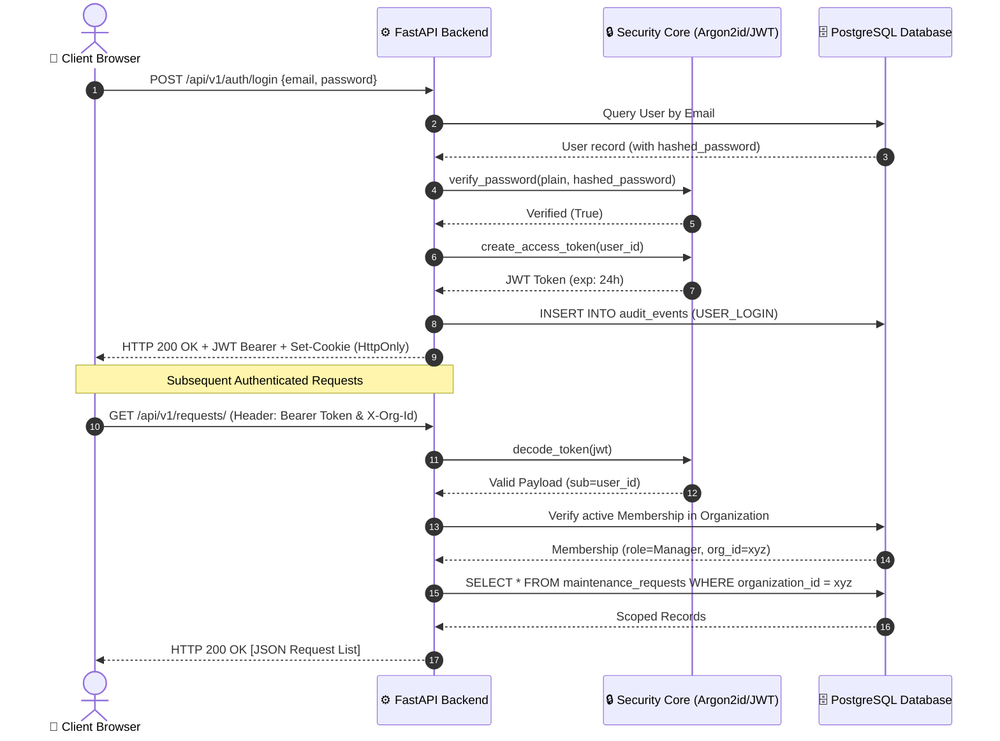
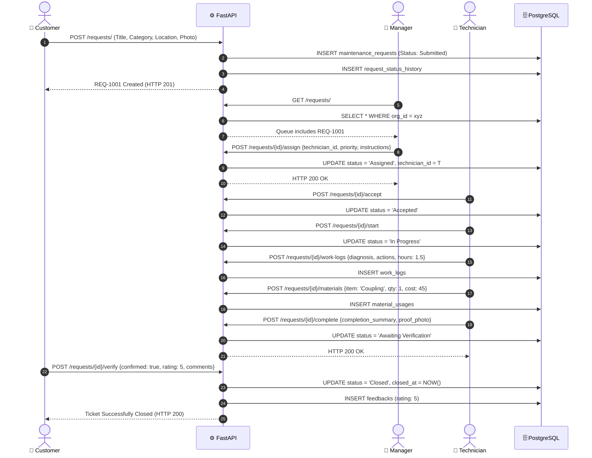

# ZERVUONO — System Architecture & Technical Design

## 1. High-Level Architecture Overview

ZERVUONO follows a decoupled, three-tier cloud-native architecture comprising a Single-Page Application (SPA) client layer, an asynchronous REST API service layer, and a cloud-hosted relational database persistence tier.



---

## 2. Frontend Architecture (React + TypeScript)

The frontend is built as a Single-Page Application (SPA) using React 18, TypeScript, and Vite. It emphasizes type safety, rapid component rendering, and zero-runtime CSS via Tailwind.

### Key Architectural Patterns
1. **Feature-Driven Modular Directory Structure:** Code is organized by domain modules (`features/auth`, `features/customer`, `features/manager`, `features/technician`, `features/admin`, `features/requests`) rather than arbitrary file types.
2. **Server-State Management via TanStack Query (React Query v5):**
   - Automatically caches API query results with defined `queryKey` tuples (e.g., `['requests', 'manager', statusFilter]`).
   - Implements automated background polling (every 10–15 seconds) so field technicians and managers receive live updates without manual page refreshes.
   - Provides clean cache invalidation on mutations (e.g., dispatching or logging work orders immediately invalidates `['requests']`).
3. **Dual-Layer Auth Session Synchronization:**
   - Auth tokens are managed in an in-memory variable for speed, backed by simultaneous synchronization to `localStorage` and `sessionStorage`.
   - Protects against hard page refreshes on mobile browsers while maintaining security.
4. **Declarative Role-Based Route Guards:**
   - `ProtectedRoute` wrapper inspects the authenticated user's role and automatically routes them to their dedicated workspace (`/customer`, `/manager`, `/technician`, `/admin`).
5. **Form Validation & Schemas:**
   - Powered by `react-hook-form` and `zod` for client-side input validation and error feedback before network dispatch.

---

## 3. Backend Architecture (FastAPI + Python 3.12)

The backend is built with FastAPI, leveraging Python's native `asyncio` loop for high-throughput, non-blocking I/O.

### Modular Architecture
```text
backend/app/
├── api/
│   ├── deps.py             # Dependency injection: get_db, get_current_user, require_roles
│   └── v1/                 # Versioned route handlers
│       ├── auth.py         # Registration, login, logout, password reset
│       ├── requests.py     # Maintenance requests lifecycle & actions
│       ├── organizations.py# Tenant management, members, invitations
│       ├── assets.py       # Physical equipment registry
│       ├── locations.py    # Facility buildings, floors, rooms
│       ├── preventive.py   # Preventive maintenance plans
│       ├── reports.py      # Operational metrics & dashboard aggregations
│       ├── files.py        # File uploads & inline streaming
│       ├── ai.py           # Gemini-assisted classification & troubleshooting
│       └── audit.py        # Compliance audit events
├── core/
│   ├── config.py           # Pydantic BaseSettings with DNS fallbacks
│   ├── security.py         # Argon2id hashing & JWT cryptographic tokens
│   └── state_machine.py    # RequestStatus enum & VALID_TRANSITIONS map
├── db/
│   ├── session.py          # SQLAlchemy 2 Engine, SessionLocal, init_tables
│   └── seed.py             # Demo organization seed script
├── models/                 # SQLAlchemy Declarative Models
└── schemas/                # Pydantic v2 Request/Response Models
```

### Dependency Injection Pipeline (`deps.py`)
Each incoming request passes through an automated dependency chain:
1. `get_db`: Yields an active SQLAlchemy `Session` from the connection pool and guarantees closure.
2. `get_token_from_request`: Extracts the token from either the `Authorization: Bearer <token>` header or the `zervuno_session` HttpOnly cookie.
3. `get_current_user`: Decodes the JWT, validates expiration, and verifies user active status in the database.
4. `get_current_membership`: Scopes the user to their active tenant using the `X-Organization-Id` header (or primary membership).
5. `require_roles(['Manager', 'Admin'])`: Enforces endpoint-level RBAC, returning `HTTP 403 Forbidden` if unauthorized.

---

## 4. Authentication & Security Flow



---

## 5. Persistent File Storage & Image Pipeline

On cloud container platforms like Render, the container filesystem is **ephemeral** (files written to disk are destroyed when the server restarts or sleeps). ZERVUONO solves this by integrating **persistent database object storage**:

```mermaid
flowchart LR
    Browser["📱 Client Browser"]
    UploadEP["POST /files/upload"]
    DB[("PostgreSQL\nattachments table\n(file_data BYTEA)")]
    ViewEP["GET /files/{id}/view"]

    Browser -->|1. Multipart File Form| UploadEP
    UploadEP -->|2. Store binary bytes in file_data| DB
    UploadEP -->|3. Return URL: /api/v1/files/{id}/view| Browser

    Browser -->|4. HTTP GET Image URL| ViewEP
    ViewEP -->|5. Read BYTEA binary stream| DB
    ViewEP -->|6. Return HTTP 200 (image/jpeg, inline)| Browser
```

### Technical Resilience Features:
- **`BYTEA` Database Persistence:** Binary image content is stored directly in Neon PostgreSQL in the `Attachment.file_data` column.
- **Resilient Delivery:** Even after Render container cold starts or complete redeployments, image links remain valid and return **HTTP 200 OK**.
- **Dual Fallback:** If configured, S3 object storage is targeted first; if unconfigured, PostgreSQL `BYTEA` storage takes over, with a local disk cache for fast local reads.

---

## 6. End-to-End Maintenance Data Flow



---

## 7. Cloud Deployment Topology

```mermaid
flowchart TD
    subgraph Internet["🌐 Public Internet / Users"]
        WebClients["Desktop & Mobile Users"]
    end

    subgraph VercelEdge["⚡ Vercel Edge Network (Global CDN)"]
        SPA_Static["Vite Production Bundle\n(HTML, CSS, JS Chunks)"]
        VercelRewrite["vercel.json Proxy Rules\n/api/* -> Render Backend\n/uploads/* -> Render Backend"]
    end

    subgraph RenderPlatform["☁️ Render Cloud Web Service (Oregon, US)"]
        AppServer["FastAPI + Uvicorn Async Server"]
        EnvConfig["Environment Variables\n• DATABASE_URL\n• SECRET_KEY\n• ENVIRONMENT=production\n• COOKIE_SECURE=true"]
    end

    subgraph NeonCloud["🐘 Neon Serverless PostgreSQL (AWS us-east-2)"]
        PgBouncer["PgBouncer Connection Pooler (:5432)"]
        StorageEngine["Compute & Storage Engine\n(ACID Tables, Indexes, BYTEA)"]
    end

    WebClients <==>|HTTPS (zervuono.vercel.app)| VercelEdge
    VercelEdge <==>|Reverse Proxy & Static Assets| SPA_Static
    VercelRewrite <==>|HTTPS (zervono-api.onrender.com)| AppServer
    AppServer <==>|Encrypted SSL / psycopg2 pool| PgBouncer
    PgBouncer <==> StorageEngine
```

This architecture provides a scalable, enterprise-grade foundation that completely decouples client presentation from business logic and database persistence.
